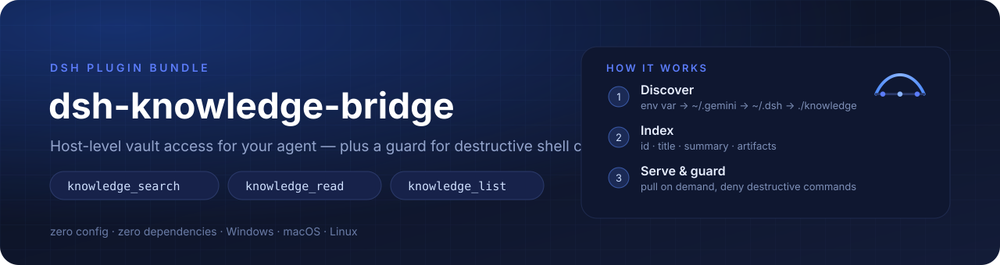
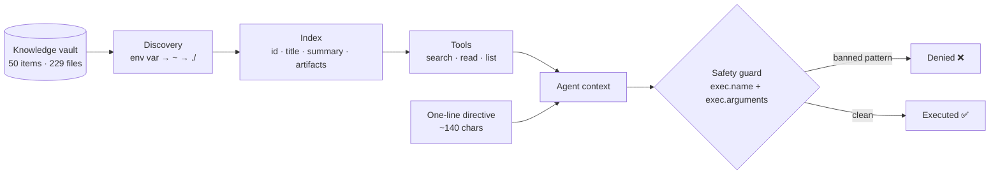

<div align="center">



**Give your DeepSeek Harness agent a brain — host-level knowledge access, zero-config vault discovery, and a safety guard for destructive shell commands.**

**ต่อสมองให้เอเจนต์ DeepSeek Harness — เข้าถึงคลังความรู้ระดับ host, ค้นหา vault อัตโนมัติแบบไม่ต้องตั้งค่า, และกันคำสั่ง shell ที่ทำลายข้อมูล**

[](https://github.com/Babydunx1/dsh-knowledge-bridge/actions/workflows/ci.yml)
[](LICENSE)
[](package.json)
[](#development)
[](#development)
[](#installation)

**English** · [ภาษาไทย](#-ภาษาไทย)

</div>

---

<div align="center">

### Architecture at a glance · ภาพรวมสถาปัตยกรรม



</div>

---

<div align="center">

### Try it in 10 seconds · ลองใช้ใน 10 วินาที

```bash
git clone https://github.com/Babydunx1/dsh-knowledge-bridge && cd dsh-knowledge-bridge
npm test          # 28 tests — unit + bundle contract, no install needed
npm run validate  # 21 static checks on the bundle contract
npm run demo      # index a sample vault and print what the agent would see
```

```text
  2 · index
      2 item(s) · 3 artifact(s)
      ├─ deploy-guide  ·  1 artifact(s)
      └─ posttracker_engine  ·  2 artifact(s)

  4 · guard (patterns are matched against the command string)
      ⛔ BLOCKED  git reset --hard HEAD~1
      ⛔ BLOCKED  rm -rf /
      ✅ allowed  git status
```

No install, no configuration, no DeepSeek Harness required.
ไม่ต้องติดตั้ง ไม่ต้องตั้งค่า ไม่ต้องเปิด DeepSeek Harness ก็ลองได้

</div>

---

## 🇬🇧 English

### Why this exists

An agent's quality is bounded by what it can *reach*, not by how smart it is. Three concrete failure modes motivated this plugin:

1. **Sandbox false negatives.** Under `workspace-write`, an agent cannot read knowledge vaults or repositories outside the active workspace. On Windows the shell turns that denial into a misleading `File Not Found`, so the agent concludes the knowledge does not exist — and starts guessing.
2. **Context amnesia.** Teams keep 50+ architecture docs, SOPs and API contracts in a vault (Antigravity's `~/.gemini/antigravity-ide/knowledge`, shared drives, `docs/`). DeepSeek Harness has no native way to discover or index them.
3. **Irreversible commands.** Autonomous agents happily run `git reset --hard`, `git clean -fd` or `git restore .` and destroy uncommitted work.

`dsh-knowledge-bridge` runs as a **host-level cordis plugin**: it reads the host filesystem with the host process's own permissions, exposes three fast retrieval tools, injects a one-line directive so the model knows a vault exists, and denies destructive shell calls before they execute.

### Goals

| Goal | How it is met |
|---|---|
| **Scoped, on-demand knowledge** | Nothing is dumped into the prompt. One ~140-character directive is injected; content is pulled per topic — `knowledge_search` → `knowledge_read`. |
| **Zero configuration** | The vault is auto-discovered from an environment variable or well-known locations. No hardcoded paths anywhere in the code. |
| **Zero dependencies** | Node.js built-ins only (`node:fs`, `node:path`, `node:os`). Nothing to install. |
| **Never destroy user work** | A monotonic guard: any matching rule denies the call, and no other plugin can force-allow it. |
| **Portable** | `~`-relative discovery, `DSH_KNOWLEDGE_PATHS` override, works with any markdown vault layout. |

#### What this plugin is *not*

- It is **not** a memory system that loads your whole vault into every prompt. A 2 MB vault is ~1M tokens: slow and expensive.
- It is **not** a vector database. Ranking is deterministic keyword scoring — predictable, debuggable, no embedding service to run.

### Features

| | Feature | Detail |
|---|---|---|
| 🧠 | `knowledge_search` | Keyword search with explicit weights: title 10 · id 8 · **aliases 8** · **tags 6** · **references 4** · summary 3 · artifact name 2 · **document body 1** (lazy, cached by mtime). Returns `id`, `title`, `score`, a clipped summary and the artifact list — never file content. |
| 📖 | `knowledge_read` | Reads a full document, or one specific artifact (`master_guide.md`, `07_migration.md`, …) on demand. |
| 🗂️ | `knowledge_list` | The vault outline: ids, titles, artifact counts, one-line previews. |
| 🔎 | Zero-config discovery | `DSH_KNOWLEDGE_PATHS` → `~/.gemini/antigravity-ide/knowledge` → `~/.antigravity-ide/knowledge` → `~/.dsh/knowledge` → `~/.codex/knowledge` → `./knowledge` → `./docs/knowledge` → `./.knowledge`. |
| 📜 | Rules injection | Discovers `AGENTS.md` / `GEMINI.md` / `CLAUDE.md` from the workspace and adds them to the system prompt. |
| 🛑 | Safety guard | Denies `bash` / `pwsh` / `cmd` / `terminal` calls whose command matches a banned pattern. |
| 🪶 | Token-aware | Tool summaries are clipped, because tool output is replayed in every later model call. |

### Installation

<details open>
<summary><b>Option A — Add plugin: paste the link (recommended, ~1 minute)</b></summary>

1. DeepSeek Harness → **Plugins** → **Add plugin**
2. Paste this address into **Package name or address**:

   ```text
   https://github.com/Babydunx1/dsh-knowledge-bridge
   ```

3. Click **Install**, then **restart DeepSeek Harness** (a restart loads a fresh JavaScript module generation)

Accepted addresses — all of these pass DSH's own check:

| Paste this | Kind |
|:--|:--|
| `https://github.com/Babydunx1/dsh-knowledge-bridge` | Git repository (recommended) |
| `github:Babydunx1/dsh-knowledge-bridge` | Git shorthand |
| `https://github.com/Babydunx1/dsh-knowledge-bridge#v1.0.0` | Git, pinned to a tag / branch / commit (`#main`, `#semver:^1.0.0`) |
| `https://github.com/Babydunx1/dsh-knowledge-bridge/archive/refs/heads/main.tar.gz` | Tarball — use this when Git is not installed on the machine |
| `git@github.com:Babydunx1/dsh-knowledge-bridge.git` | Git over SSH |

A GitHub **page** URL with extra path segments (e.g. `.../tree/main`) is refused with *"a URL must point at a git repository or a tarball"*.

Command-line equivalent (same code path as the dialog):

```bash
dsh plugin --profile <profile> add https://github.com/Babydunx1/dsh-knowledge-bridge
```

Updating later — installed plugins do **not** auto-update yet:

```bash
dsh plugin --profile <profile> update dsh-knowledge-bridge
# or: Plugins → uninstall → Add plugin again
```

The package declares `dsh.bundle.patch`, so DSH registers the bundle and applies [`cordis.patch.yml`](cordis.patch.yml) for you.

📖 **Full step-by-step with verification checks: [docs/INSTALL.md](https://github.com/Babydunx1/dsh-knowledge-bridge/blob/main/docs/INSTALL.md)**

</details>

<details>
<summary><b>Option B — as a DSH profile bundle (manual equivalent of Option A)</b></summary>

Use this only when the dialog is unavailable. It is exactly what Option A does under the hood.

The package declares `dsh.bundle.patch`, so DSH can install it like any other bundle.

```powershell
# 1. Clone / copy the package somewhere permanent
git clone https://github.com/Babydunx1/dsh-knowledge-bridge dsh-knowledge-bridge

# 2. Register it in your profile
#    ~/.dsh/profiles/<profile>/package.json
{
  "dsh": { "profile": { "bundles": ["@deepseek-ai/dsh-base", "@deepseek-ai/dsh-web-app", "dsh-knowledge-bridge"] } },
  "dependencies": { "dsh-knowledge-bridge": "link:/absolute/path/to/dsh-knowledge-bridge" }
}

# 3. Install the link
cd ~/.dsh/profiles/<profile>
pnpm install
```

Restart DeepSeek Harness. The plugin is applied from [`cordis.patch.yml`](cordis.patch.yml).

</details>

<details>
<summary><b>Option C — hand-merged profile patch</b></summary>

Copy the `insert` row from [`cordis.patch.yml`](cordis.patch.yml) into `~/.dsh/profiles/<profile>/cordis.patch.yml` and restart DSH.

</details>

<details>
<summary><b>Option D — point at your own vault</b></summary>

Nothing to configure when your vault is in a standard location. Otherwise:

```powershell
# Windows (PowerShell) — semicolon or comma separated
$env:DSH_KNOWLEDGE_PATHS = "D:/team-docs/knowledge;~/my-vault"
```

```bash
# macOS / Linux
export DSH_KNOWLEDGE_PATHS="$HOME/my-vault:$HOME/team-docs"
```

…or set it explicitly in the patch: `knowledgePaths: ["~/my-vault"]`.

</details>

### Configuration reference

Every key is optional; the defaults below are what a zero-config install uses.

| Key | Type | Default | Meaning |
|---|---|---|---|
| `knowledgePaths` | `string[]` | `[]` → auto-discovery | Vault roots. `~` is expanded; relative paths resolve against the workspace cwd. Explicit paths win, and still combine with `DSH_KNOWLEDGE_PATHS`. |
| `rulesPaths` | `string[]` | `["AGENTS.md","GEMINI.md","CLAUDE.md"]` | Files probed at the workspace root and injected as a prompt section. |
| `autoInjectRules` | `boolean` | `true` | Inject the rules section plus the one-line knowledge directive. Set `false` for a completely untouched prompt. |
| `enableSafetyGuard` | `boolean` | `true` | Enable the destructive-command guard. |
| `bannedPatterns` | `string[]` | see below | Case-insensitive regular expressions matched against the command string. |

```js
bannedPatterns: [
  'git\\s+reset\\s+--hard',
  'git\\s+clean\\s+-fd',
  'git\\s+restore\\s+\\.',
  'rm\\s+-rf\\s+/(?!tmp)',
]
```

If the vault cannot be found the plugin logs `Initialized with 0 path(s)` — check that line first when nothing is indexed.

### Supported vault layouts

**A. Structured items** (Antigravity and similar multi-file vaults):

```text
knowledge/
└── posttracker_engine/
    ├── metadata.json          # title, summary + optional tags / aliases / references
    ├── timestamps.json        # optional
    └── artifacts/
        ├── master_guide.md    # read first: table of contents + current status
        ├── 01_watchdog.md
        └── 02_reconciliation.md
```

`metadata.json` fields, in search-weight order:

| Field | Weight | Use it for |
|---|---|---|
| `title` | 10 | the human name of the item |
| `tags` | 6 | topic words (`reconciliation`, `pos`, `payroll`) |
| `aliases` | 8 | the words *you* actually type, especially Thai/English pairs (`ระบบลา`, `leave`, `ลาพักร้อน`) |
| `references` | 4 | real file paths or symbols (`src/pages/LeaveRequestPage.tsx`, `migration 024`) |
| `summary` | 3 | one paragraph of context, clipped to 400 chars in results |

The document **bodies are searched too** (+1) as a last resort, so a symbol that only appears
inside a file is still findable — but a body hit always ranks below a metadata hit.

**B. Plain markdown** — any directory tree of `.md` / `.txt` files:

```text
knowledge/
├── architecture.md
├── deploy-guide.md
└── deployment/
    └── README.md
```

Recommended read order, which keeps context small: item outline → `master_guide.md` → the one numbered artifact that matches the task → source code.

### How the safety guard behaves

- The guard inspects the **execution object DSH passes to `tools.guard()`**: `exec.name` (tool name) and `exec.arguments` (parsed arguments). *Not* `exec.tool` / `exec.args` — reading those yields `undefined` and the guard silently never fires.
- It only inspects `bash`, `pwsh`, `cmd`, `terminal`; every other tool returns `undefined` and runs normally.
- A denial returns a reason beginning with `[BLOCKED BY DSH-KNOWLEDGE-BRIDGE SAFETY POLICY]`, surfaced by the runtime as `Error: ...`.
- The guard is **monotonic**: a denial cannot be overridden by another plugin.

### Development

```bash
npm test           # 28 tests: engine, host plugin, bundle contract
npm run validate   # 21 static checks on the bundle contract
npm run demo       # index examples/vault and print the agent's view
npm run demo -- ~/my-vault --query deployment   # or any other vault
```

Narrower runs while iterating:

```bash
node --test lib/knowledge.test.js          # discovery, index, search, read
node --test lib/index.test.js              # tools, guard contract, prompt sections
node --test scripts/validate-bundle.test.js # the validator refuses broken bundles
```

No network, no writes outside a temp directory, and **no install step** — the CI matrix runs the
same commands on Linux and Windows across Node 20/22/24. In a sandboxed DSH session the OS temp
directory may be read-only; point `TEMP`/`TMP` at a writable directory first.

```text
index.js                       cordis host plugin: inject, tools, guard, prompt sections
lib/knowledge.js               pure engine: discovery, index, search, read, rules loading
cordis.patch.yml               bundle patch row applied by DSH
locale/{en,th}.json            Plugin Manager display title and description
assets/{banner,logo}.svg       repo artwork
scripts/demo.mjs               zero-install demo (npm run demo)
scripts/validate-bundle.js     21 static bundle-contract checks (npm run validate)
scripts/validate-bundle.test.js  proves the validator refuses broken bundles
examples/vault/                sample vault in both supported layouts
lib/*.test.js                  node:test suites
.github/workflows/ci.yml       test matrix (no install step)
CHANGELOG.md                   release history
CONTRIBUTING.md                invariants a pull request must keep
SECURITY.md                    what counts as a vulnerability here
CODE_OF_CONDUCT.md             Contributor Covenant 2.1
```

Quality gates a change must pass:

| Gate | Command | What it protects |
|---|---|---|
| Unit tests | `npm test` | engine behaviour, tool payload clipping, the guard's real `exec` contract |
| Bundle contract | `npm run validate` | `inject` completeness, ports/ESM shape, no absolute user paths, patch wiring |
| Demo | `npm run demo` | a fresh clone still discovers and indexes a vault |

### Troubleshooting

| Symptom | Cause / fix |
|---|---|
| `Error: cannot get property "X" without inject`, entry fails to activate | Every cordis service you read must be listed in `export const inject`. Reading `ctx.systemPrompt` inside an `if (...)` condition (or behind `?.`) still throws — the read itself is the failure. Keep service reads inside `try`, and never drop `'systemPrompt'` from `inject`. |
| Entry stays **pending** instead of failing | A declared service does not exist yet. Nothing throws; DSH reports `pending (waiting for service: …)`. Check the service name and that its provider plugin is enabled. |
| Edited the plugin but behaviour is unchanged | cordis caches the plugin *function* and ESM caches the module. Toggling off/on does not re-import. **Restart the DSH host.** |
| `Initialized with 0 path(s)` | Vault not found. Set `DSH_KNOWLEDGE_PATHS` or `knowledgePaths`, and confirm the path exists as a directory. |
| Guard never blocks anything | The guard must read `exec.name` / `exec.arguments`. Snippets using `exec.tool` / `exec.args` never match. |

---

## 🇹🇭 ภาษาไทย

### ทำไมต้องมีปลั๊กอินนี้

คุณภาพของเอเจนต์ไม่ได้ขึ้นกับความฉลาดอย่างเดียว แต่ขึ้นกับว่า **มันเอื้อมถึงอะไรได้** ปัญหาจริง 3 ข้อที่ทำให้เกิดปลั๊กอินนี้:

1. **Sandbox หลอกว่า "ไม่พบไฟล์"** — โหมด `workspace-write` อ่าน vault หรือ repo นอก workspace ไม่ได้ และบน Windows shell จะแปลง error เป็น `File Not Found` ทำให้เอเจนต์สรุปว่า "ความรู้ไม่มีอยู่" แล้วเริ่มเดาสุ่ม
2. **ความจำขาดตอน** — ทีมเก็บเอกสารสถาปัตยกรรม SOP และ API contract ไว้ 50+ ฉบับใน vault (เช่น `~/.gemini/antigravity-ide/knowledge`, ไดรฟ์แชร์, `docs/`) แต่ DeepSeek Harness ไม่มีวิธีค้นหา/index ไฟล์พวกนี้
3. **คำสั่งที่ย้อนกลับไม่ได้** — เอเจนต์อัตโนมัติเผลอรัน `git reset --hard`, `git clean -fd`, `git restore .` แล้วงานที่ยังไม่ commit หายหมด

`dsh-knowledge-bridge` ทำงานเป็น **cordis plugin ระดับ host**: อ่านไฟล์ด้วยสิทธิ์ของ process หลักของแอป เปิด tool ค้นหา 3 ตัว ฉีด directive บรรทัดเดียวให้โมเดลรู้ว่ามีคลังอยู่ และสกัดคำสั่ง shell ที่อันตรายก่อนจะถึงดิสก์

### เป้าหมาย

| เป้าหมาย | วิธีที่ทำได้จริง |
|---|---|
| **ความรู้แบบเจาะจง ดึงเมื่อต้องใช้** | ไม่ยัดอะไรลง prompt เลย นอกจาก directive ~140 ตัวอักษร แล้วดึงเนื้อหาตามหัวข้อผ่าน `knowledge_search` → `knowledge_read` |
| **ไม่ต้องตั้งค่า** | ค้นหา vault เองจาก env var หรือตำแหน่งมาตรฐาน ไม่มี path ฝังในโค้ดแม้แต่บรรทัดเดียว |
| **ไม่มี dependency** | ใช้ built-in ของ Node.js เท่านั้น (`node:fs`, `node:path`, `node:os`) ไม่ต้องติดตั้งอะไรเพิ่ม |
| **ไม่ทำลายงานของผู้ใช้** | guard แบบ monotonic: แมตช์กฎแล้วปฏิเสธทันที และปลั๊กอินอื่นบังคับให้ผ่านไม่ได้ |
| **ย้ายเครื่องได้** | discovery อ้างอิง `~`, override ด้วย `DSH_KNOWLEDGE_PATHS`, ใช้ได้กับ vault รูปแบบ markdown ใดก็ได้ |

#### สิ่งที่ปลั๊กอินนี้ **ไม่ใช่**

- **ไม่ใช่** ระบบที่โหลด vault ทั้งก้อนเข้า prompt ทุกครั้ง — vault 2 MB ≈ 1 ล้านโทเคน ช้าและแพง
- **ไม่ใช่** vector database — การจัดอันดับใช้ keyword scoring แบบ deterministic ทำนายผลได้ debug ง่าย ไม่ต้องรัน embedding service

### ฟีเจอร์

| | ฟีเจอร์ | รายละเอียด |
|---|---|---|
| 🧠 | `knowledge_search` | ค้น keyword พร้อมน้ำหนักชัดเจน: title 10 · id 8 · **aliases 8** · **tags 6** · **references 4** · summary 3 · ชื่อ artifact 2 · **เนื้อในไฟล์ 1** (อ่านแบบ lazy + cache ตาม mtime) — คืน `id`, `title`, `score`, summary ที่ตัดแล้ว และรายชื่อ artifact **ไม่คืนเนื้อไฟล์** |
| 📖 | `knowledge_read` | อ่านเอกสารเต็ม หรืออ่าน artifact ทีละไฟล์ (`master_guide.md`, `07_migration.md`, …) ตามต้องการ |
| 🗂️ | `knowledge_list` | สารบัญทั้งคลัง: id, title, จำนวน artifact และคำโปรยบรรทัดเดียว |
| 🔎 | ค้นหา vault อัตโนมัติ | `DSH_KNOWLEDGE_PATHS` → `~/.gemini/antigravity-ide/knowledge` → `~/.antigravity-ide/knowledge` → `~/.dsh/knowledge` → `~/.codex/knowledge` → `./knowledge` → `./docs/knowledge` → `./.knowledge` |
| 📜 | ฉีดกฎโปรเจกต์ | ค้น `AGENTS.md` / `GEMINI.md` / `CLAUDE.md` จาก workspace แล้วใส่เข้า system prompt |
| 🛑 | Safety guard | ปฏิเสธคำสั่งของ `bash` / `pwsh` / `cmd` / `terminal` ที่เข้าเกณฑ์ regex ต้องห้าม |
| 🪶 | ประหยัดโทเคน | summary ที่ tool คืนถูกตัดความยาว เพราะผลลัพธ์ tool จะถูกส่งซ้ำในทุกเทิร์นถัดไป |

### การติดตั้ง

<details open>
<summary><b>วิธี A — Add plugin: วางลิงก์ (แนะนำ ใช้เวลา ~1 นาที)</b></summary>

1. DeepSeek Harness → **Plugins** → **Add plugin**
2. วางที่อยู่นี้ในช่อง **Package name or address**:

   ```text
   https://github.com/Babydunx1/dsh-knowledge-bridge
   ```

3. กด **Install** แล้ว **รีสตาร์ท DeepSeek Harness** (ต้องรีสตาร์ทเพื่อโหลดโมดูลชุดใหม่)

ลิงก์ที่ใช้ได้ (ผ่านตัวตรวจของ DSH ทั้งหมด):

| วางแบบนี้ | ประเภท |
|:--|:--|
| `https://github.com/Babydunx1/dsh-knowledge-bridge` | Git repository (แนะนำ) |
| `github:Babydunx1/dsh-knowledge-bridge` | Git shorthand |
| `https://github.com/Babydunx1/dsh-knowledge-bridge#v1.0.0` | Git + ปัก tag / branch / commit (`#main`, `#semver:^1.0.0`) |
| `https://github.com/Babydunx1/dsh-knowledge-bridge/archive/refs/heads/main.tar.gz` | Tarball — ใช้เมื่อเครื่องไม่มี Git |
| `git@github.com:Babydunx1/dsh-knowledge-bridge.git` | Git ผ่าน SSH |

ลิงก์หน้าเว็บ GitHub ที่มี path เกิน (เช่น `.../tree/main`) จะถูกปฏิเสธด้วยข้อความ *"a URL must point at a git repository or a tarball"*

เทียบเท่าผ่าน command line (โค้ดเส้นทางเดียวกับในหน้าต่าง):

```bash
dsh plugin --profile <profile> add https://github.com/Babydunx1/dsh-knowledge-bridge
```

การอัปเดตภายหลัง — ปลั๊กอินที่ติดตั้งแล้ว **ยังไม่มี auto-update**:

```bash
dsh plugin --profile <profile> update dsh-knowledge-bridge
# หรือ: Plugins → ถอน (uninstall) → Add plugin ใหม่
```

แพ็กเกจประกาศ `dsh.bundle.patch` ไว้แล้ว DSH จึงลงทะเบียน bundle และ apply [`cordis.patch.yml`](cordis.patch.yml) ให้เอง

📖 **คู่มือทีละขั้น + วิธีตรวจหลังติดตั้ง: [docs/INSTALL.md](https://github.com/Babydunx1/dsh-knowledge-bridge/blob/main/docs/INSTALL.md)**

</details>

<details>
<summary><b>วิธี B — ติดตั้งเป็น DSH profile bundle (แบบ manual เทียบเท่าวิธี A)</b></summary>

ใช้เฉพาะเมื่อหน้าต่าง Add plugin ใช้ไม่ได้ — ขั้นตอนนี้คือสิ่งที่วิธี A ทำอยู่เบื้องหลัง

แพ็กเกจประกาศ `dsh.bundle.patch` ไว้แล้ว จึงติดตั้งเหมือน bundle อื่นของ DSH

```powershell
# 1. โคลน / คัดลอกแพ็กเกจไปเก็บถาวร
git clone https://github.com/Babydunx1/dsh-knowledge-bridge dsh-knowledge-bridge

# 2. ลงทะเบียนใน profile ของคุณ
#    ~/.dsh/profiles/<profile>/package.json
{
  "dsh": { "profile": { "bundles": ["@deepseek-ai/dsh-base", "@deepseek-ai/dsh-web-app", "dsh-knowledge-bridge"] } },
  "dependencies": { "dsh-knowledge-bridge": "link:/absolute/path/to/dsh-knowledge-bridge" }
}

# 3. ติดตั้ง link
cd ~/.dsh/profiles/<profile>
pnpm install
```

รีสตาร์ท DeepSeek Harness — ปลั๊กอินจะถูก apply จาก [`cordis.patch.yml`](cordis.patch.yml)

</details>

<details>
<summary><b>วิธี C — merge patch เองในโปรไฟล์</b></summary>

คัดลอกแถว `insert` จาก [`cordis.patch.yml`](cordis.patch.yml) ไปวางใน `~/.dsh/profiles/<profile>/cordis.patch.yml` แล้วรีสตาร์ท DSH

</details>

<details>
<summary><b>วิธี D — ชี้ไปที่ vault ของตัวเอง</b></summary>

ถ้า vault อยู่ในตำแหน่งมาตรฐาน ไม่ต้องตั้งค่าอะไรเลย มิฉะนั้น:

```powershell
# Windows (PowerShell) — คั่นด้วย ; หรือ ,
$env:DSH_KNOWLEDGE_PATHS = "D:/team-docs/knowledge;~/my-vault"
```

```bash
# macOS / Linux
export DSH_KNOWLEDGE_PATHS="$HOME/my-vault:$HOME/team-docs"
```

…หรือระบุตรง ๆ ใน patch: `knowledgePaths: ["~/my-vault"]`

</details>

### ตารางตั้งค่า (config)

ทุกคีย์เป็น optional ค่า default ด้านล่างคือสิ่งที่ใช้เมื่อติดตั้งแบบไม่ตั้งค่าอะไร

| คีย์ | ชนิด | ค่าเริ่มต้น | ความหมาย |
|---|---|---|---|
| `knowledgePaths` | `string[]` | `[]` → ค้นหาอัตโนมัติ | root ของ vault, `~` ถูก expand, path สัมพัทธ์อ้างอิง cwd ของ workspace, path ที่ตั้งเองมีความสำคัญสูงสุดและยังรวมกับ `DSH_KNOWLEDGE_PATHS` |
| `rulesPaths` | `string[]` | `["AGENTS.md","GEMINI.md","CLAUDE.md"]` | ไฟล์ที่จะค้นจาก root ของ workspace แล้วฉีดเป็น section ใน prompt |
| `autoInjectRules` | `boolean` | `true` | ฉีดทั้งกฎโปรเจกต์และ directive บรรทัดเดียว ถ้าตั้ง `false` prompt จะไม่ถูกแตะเลย |
| `enableSafetyGuard` | `boolean` | `true` | เปิด guard กันคำสั่งทำลายข้อมูล |
| `bannedPatterns` | `string[]` | ดูด้านล่าง | regex (ไม่แคร์ตัวพิมพ์ใหญ่เล็ก) ใช้เทียบกับ command string |

```js
bannedPatterns: [
  'git\\s+reset\\s+--hard',
  'git\\s+clean\\s+-fd',
  'git\\s+restore\\s+\\.',
  'rm\\s+-rf\\s+/(?!tmp)',
]
```

ถ้าหา vault ไม่เจอ ปลั๊กอินจะ log ว่า `Initialized with 0 path(s)` — ให้ดูบรรทัดนี้ก่อนเป็นอันดับแรกเมื่อไม่มีอะไรถูก index

### รูปแบบ vault ที่รองรับ

**A. แบบมีโครงสร้าง** (vault หลายไฟล์สไตล์ Antigravity):

```text
knowledge/
└── posttracker_engine/
    ├── metadata.json          # title, summary + tags / aliases / references (ไม่บังคับ)
    ├── timestamps.json        # ไม่บังคับ
    └── artifacts/
        ├── master_guide.md    # อ่านตัวนี้ก่อน: สารบัญ + สถานะล่าสุด
        ├── 01_watchdog.md
        └── 02_reconciliation.md
```

ฟิลด์ใน `metadata.json` เรียงตามน้ำหนักการค้น:

| ฟิลด์ | น้ำหนัก | ใช้กับอะไร |
|---|---|---|
| `title` | 10 | ชื่อที่คนอ่านเข้าใจ |
| `aliases` | 8 | คำที่**คุณพิมพ์จริง** โดยเฉพาะคู่ไทย/อังกฤษ (`ระบบลา`, `leave`, `ลาพักร้อน`) |
| `tags` | 6 | คำหมวดหมู่ (`reconciliation`, `pos`, `payroll`) |
| `references` | 4 | path ไฟล์หรือชื่อ symbol จริง (`src/pages/LeaveRequestPage.tsx`, `migration 024`) |
| `summary` | 3 | ย่อหน้าอธิบายบริบท ถูกตัดเหลือ 400 ตัวอักษรในผลค้น |

**เนื้อในไฟล์ก็ถูกค้นด้วย** (+1) เป็นทางเลือกสุดท้าย symbol ที่ปรากฏแค่ในไฟล์จึงหาเจอ แต่จะถูกจัดอันดับต่ำกว่าเสมอถ้า metadata match

**B. markdown ธรรมดา** — โฟลเดอร์อะไรก็ได้ที่มีไฟล์ `.md` / `.txt`:

```text
knowledge/
├── architecture.md
├── deploy-guide.md
└── deployment/
    └── README.md
```

ลำดับการอ่านที่แนะนำ (ประหยัด context): ดูสารบัญ item → `master_guide.md` → ไฟล์ `NN_*.md` ที่ตรงกับงานนั้น → แล้วค่อยไปดูซอร์สโค้ด

### พฤติกรรมของ safety guard

- guard ตรวจ **execution object ที่ DSH ส่งให้ `tools.guard()`**: `exec.name` (ชื่อ tool) และ `exec.arguments` (อาร์กิวเมนต์ที่ parse แล้ว) — **ไม่ใช่** `exec.tool` / `exec.args` เพราะสองตัวนั้นอ่านได้ `undefined` แล้ว guard จะไม่ทำงานแบบเงียบ ๆ
- ตรวจเฉพาะ `bash`, `pwsh`, `cmd`, `terminal`; tool อื่นคืน `undefined` และทำงานปกติ
- เมื่อถูกปฏิเสธจะคืนข้อความขึ้นต้นด้วย `[BLOCKED BY DSH-KNOWLEDGE-BRIDGE SAFETY POLICY]` และ runtime จะแสดงเป็น `Error: ...`
- guard เป็น **monotonic**: คำสั่งที่ถูกปฏิเสธแล้ว ปลั๊กอินอื่นบังคับให้ผ่านไม่ได้

### การพัฒนาและทดสอบ

```bash
npm test           # 28 เทสต์: engine, host plugin, bundle contract
npm run validate   # 21 checks แบบ static บนสัญญาของ bundle
npm run demo       # index examples/vault แล้วแสดงสิ่งที่เอเจนต์จะเห็น
npm run demo -- ~/my-vault --query deployment   # หรือชี้ vault อื่นก็ได้
```

รันเฉพาะชุดที่ต้องการระหว่างพัฒนา:

```bash
node --test lib/knowledge.test.js           # discovery, index, search, read
node --test lib/index.test.js               # tools, guard contract, prompt sections
node --test scripts/validate-bundle.test.js # ตัว validator ต้องปฏิเสธ bundle ที่พัง
```

ไม่ต่อเน็ต ไม่เขียนไฟล์นอกโฟลเดอร์ temp และ **ไม่ต้องติดตั้งอะไรเลย** — CI รันคำสั่งเดียวกันบน Linux
และ Windows กับ Node 20/22/24 ถ้ารันในเซสชัน DSH ที่มี sandbox โฟลเดอร์ temp ของระบบอาจเขียนไม่ได้
ให้ตั้ง `TEMP`/`TMP` ไปที่ที่เขียนได้ก่อน

```text
index.js                       cordis host plugin: inject, tools, guard, prompt sections
lib/knowledge.js               engine ล้วน: discovery, index, search, read, โหลดไฟล์กฎ
cordis.patch.yml               แถว patch ของ bundle ที่ DSH นำไปใช้
locale/{en,th}.json            ชื่อและคำอธิบายที่แสดงใน Plugin Manager
assets/{banner,logo}.svg       ภาพประกอบของรีโป
scripts/demo.mjs               เดโมไม่ต้องติดตั้ง (npm run demo)
scripts/validate-bundle.js     21 checks ของสัญญา bundle (npm run validate)
scripts/validate-bundle.test.js พิสูจน์ว่า validator ปฏิเสธ bundle ที่พังจริง
examples/vault/                vault ตัวอย่างทั้ง 2 รูปแบบที่รองรับ
lib/*.test.js                  ชุดเทสต์ node:test
.github/workflows/ci.yml       test matrix (ไม่มีขั้นตอนติดตั้ง)
CHANGELOG.md                   ประวัติเวอร์ชัน
CONTRIBUTING.md                ข้อกำหนดที่ PR ต้องรักษา
SECURITY.md                    อะไรถือเป็นช่องโหว่ของปลั๊กอินนี้
CODE_OF_CONDUCT.md             Contributor Covenant 2.1
```

ประตูคุณภาพที่ทุกการแก้ต้องผ่าน:

| ประตู | คำสั่ง | ป้องกันอะไร |
|---|---|---|
| Unit tests | `npm test` | พฤติกรรม engine, การตัด payload ของ tool, สัญญา `exec` จริงของ guard |
| Bundle contract | `npm run validate` | ความครบของ `inject`, รูปแบบ ESM/พอร์ต, ห้ามมี absolute path ของผู้ใช้, การต่อ patch |
| Demo | `npm run demo` | โคลนใหม่แล้วยังค้นเจอและ index vault ได้จริง |

### แก้ปัญหาที่พบบ่อย

| อาการ | สาเหตุ / วิธีแก้ |
|---|---|
| `Error: cannot get property "X" without inject` แล้ว entry ไม่ activate | ทุก service ของ cordis ที่อ่านต้องอยู่ใน `export const inject` — การอ่าน `ctx.systemPrompt` ในเงื่อนไข `if (...)` หรือหลัง `?.` ก็ยัง throw เพราะตัวการคือ "การอ่าน" เอง ให้อ่านใน `try` และห้ามลบ `'systemPrompt'` ออกจาก `inject` |
| entry ค้างเป็น **pending** แทนที่จะ fail | service ที่ประกาศไว้ยังไม่มีผู้ provide — ไม่มี exception ใด ๆ DSH จะรายงาน `pending (waiting for service: …)` ให้เช็คชื่อ service และดูว่าปลั๊กอินที่ให้ service นั้นถูกเปิดอยู่ไหม |
| แก้โค้ดปลั๊กอินแล้วพฤติกรรมไม่เปลี่ยน | cordis แคชตัว *ฟังก์ชัน* ของ plugin และ ESM แคชโมดูล การ toggle ปิด/เปิดไม่ทำให้ import ใหม่ → **ต้องรีสตาร์ท host** |
| `Initialized with 0 path(s)` | หา vault ไม่เจอ ตั้ง `DSH_KNOWLEDGE_PATHS` หรือ `knowledgePaths` และเช็คว่า path นั้นเป็นโฟลเดอร์จริง |
| guard ไม่บล็อกอะไรเลย | guard ต้องอ่าน `exec.name` / `exec.arguments` โค้ดที่ใช้ `exec.tool` / `exec.args` จะไม่แมตช์เลย |

---

## 📄 License · สัญญาอนุญาต

MIT License — see [LICENSE](LICENSE). Use it, fork it, ship it.
สัญญาอนุญาต MIT — ดูไฟล์ [LICENSE](LICENSE) ใช้ แก้ไข และเผยแพร่ได้เลย
